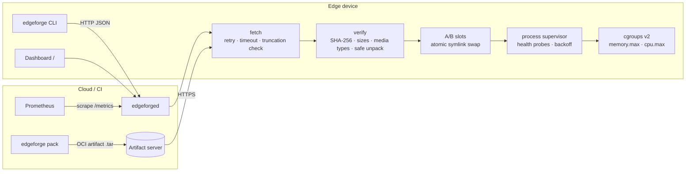
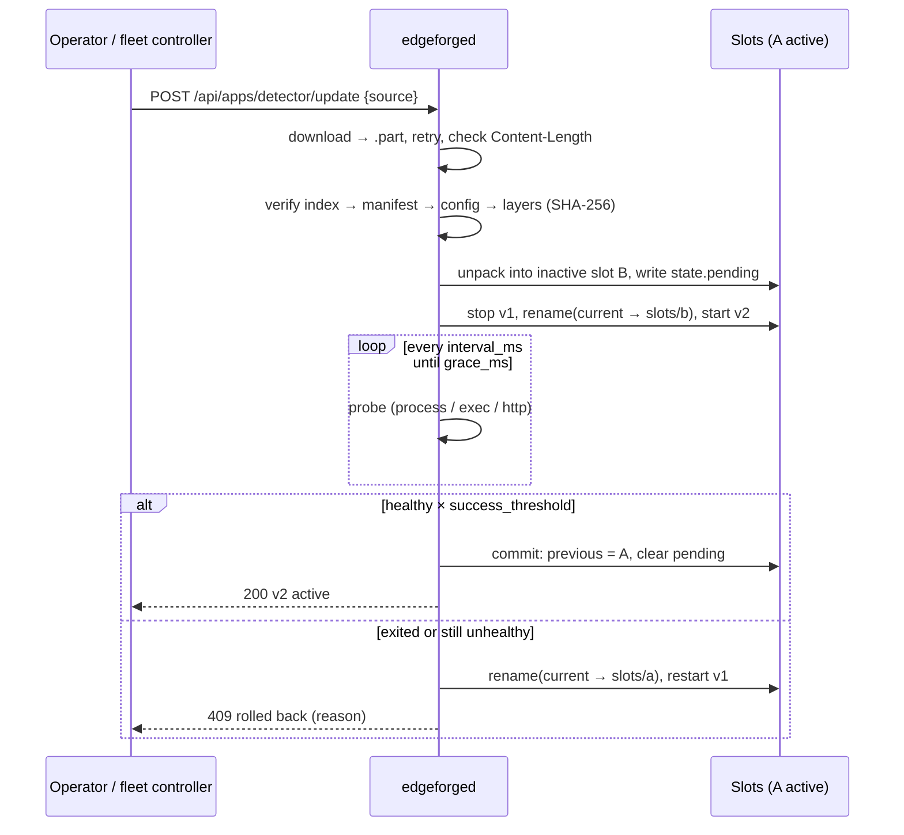

# EdgeForge

[](https://github.com/mohitrathore7/edgeforge/actions/workflows/ci.yml)


**A Rust-based on-device lifecycle manager for AI applications on Linux edge devices.**

EdgeForge is a small daemon (`edgeforged`) plus a CLI (`edgeforge`) that installs, runs,
health-checks, updates and rolls back AI apps on devices such as Jetson boards, Raspberry Pis or
industrial gateways. Apps are shipped as **OCI image-layout artifacts** whose every blob is
**SHA-256 verified**, updated **over the air with atomic A/B slots**, rolled back
**automatically** when a release crashes or fails its health checks, confined with
**cgroups v2** CPU/memory limits and observed through **Prometheus** metrics.

No container runtime is required: an app is just files plus an entrypoint, which keeps the
footprint small (idle daemon ≈ 4 MB RSS, 4.9 MB stripped binary).

---

## Features

| | |
|---|---|
| **7 lifecycle operations** | `install` · `start` · `stop` · `restart` · `update` (OTA) · `rollback` · `remove`, plus `status` / `list` |
| **OCI artifacts** | Standard image layout (`oci-layout`, `index.json`, `blobs/sha256/…`); the full chain index → manifest → config → layers is checked for size *and* SHA-256 before anything is unpacked |
| **Safe unpacking** | Rejects `..` paths, absolute paths, symlinks, hard links and device nodes in layers |
| **Atomic A/B updates** | New version goes to the inactive slot; `current` symlink is swapped with a single `rename(2)`; state is written via temp file + `fsync` + rename |
| **Automatic rollback** | Health-gated updates: if the new version exits or doesn't pass N consecutive probes within `grace_ms`, the old slot is restored and restarted |
| **Power-loss recovery** | An update in flight is recorded as a `pending` transaction; on next boot it is rolled back to the last known-good slot |
| **Resilient downloads** | Per-attempt timeouts, retries with exponential backoff, `Content-Length` truncation check, `.part` files |
| **Health probes** | `process`, `exec` (command exit code) or `http` (2xx) with interval, timeout, success/failure thresholds |
| **Supervision** | Crash detection, exponential restart backoff, crash-loop parking after `max_restarts` |
| **cgroups v2** | Per-app `memory.max` and `cpu.max` (millicores); usage read from `memory.current` / `cpu.stat`, `/proc` fallback when cgroups are unavailable |
| **Observability** | `/metrics` in Prometheus text format, example alert rules, built-in web dashboard |

## Architecture



### Update and rollback flow



On-disk layout per app:

```text
/var/lib/edgeforge/apps/detector/
├── current -> slots/a      # swapped atomically
├── slots/{a,b}/            # unpacked files of each version
├── meta/{a,b}.json         # spec + manifest digest per slot
├── state.json              # active, previous, pending update, desired state
└── logs/app.log            # app stdout/stderr
```

## Quick start

```bash
cargo build --release

# Package the example app (a small demo inference service with an HTTP health endpoint)
./target/release/edgeforge pack examples/detector -o detector-1.0.0.tar
./target/release/edgeforge verify detector-1.0.0.tar

# Run the daemon (as root for cgroups, or with --no-cgroups)
sudo ./target/release/edgeforged --root /var/lib/edgeforge --listen 127.0.0.1:9100

# Install, start and watch it
./target/release/edgeforge install detector-1.0.0.tar --start
./target/release/edgeforge list
```

```text
NAME                 VERSION    SLOT  HEALTH          PID  MEM(MiB) RESTARTS
detector             1.0.0      a     healthy       22175      18.6        0
```

Open `http://127.0.0.1:9100/` for the dashboard and `/metrics` for Prometheus.

`scripts/demo.sh` runs the whole story end to end — install, OTA update A→B, manual rollback, then
a broken release that is rolled back automatically:

```text
==> OTA update to broken v1.1.0 (expected: automatic rollback)
error: update rolled back: v1.1.0 exited during health gate (exit status: 2) (HTTP 409)
NAME                 VERSION    SLOT  HEALTH          PID  MEM(MiB) RESTARTS
detector             1.0.0      a     healthy       22194      18.6        0
```

## App spec

Each app directory contains an `edgeforge.json`, which `edgeforge pack` stores as the OCI config
blob (`application/vnd.edgeforge.app.config.v1+json`):

```json
{
  "name": "detector",
  "version": "1.0.0",
  "entrypoint": ["python3", "server.py"],
  "env": { "PORT": "8081", "MODEL_PATH": "model/labels.txt" },
  "health": {
    "probe": { "kind": "http", "url": "http://127.0.0.1:8081/healthz" },
    "interval_ms": 500, "timeout_ms": 1000,
    "success_threshold": 3, "failure_threshold": 3, "grace_ms": 10000
  },
  "resources": { "memory_max_bytes": 268435456, "cpu_max_millicores": 500 },
  "restart": { "max_restarts": 5, "backoff_ms": 1000, "stable_ms": 30000 }
}
```

Unknown fields are rejected, so a typo cannot silently disable a limit.

## HTTP API

| Method | Path | Action |
|---|---|---|
| `GET` | `/` | Web dashboard |
| `GET` | `/healthz` | Daemon liveness |
| `GET` | `/metrics` | Prometheus metrics |
| `GET` | `/api/apps` | List apps |
| `POST` | `/api/apps` | Install `{"source": "<path or URL>", "start": true}` |
| `GET` | `/api/apps/{name}` | App status |
| `POST` | `/api/apps/{name}/start` \| `stop` \| `restart` \| `rollback` | Lifecycle actions |
| `POST` | `/api/apps/{name}/update` | OTA update `{"source": "<path or URL>"}` |
| `DELETE` | `/api/apps/{name}` | Stop and remove |

Errors are JSON (`{"error": "rolled_back", "message": "…"}`) with meaningful status codes:
`422` failed verification, `502` download failure, `409` rolled back / already installed, `404` unknown app.

## Metrics

| Metric | Type | Labels |
|---|---|---|
| `edgeforge_app_up` | gauge | `app` |
| `edgeforge_app_healthy` | gauge | `app` |
| `edgeforge_app_info` | gauge | `app`, `version`, `slot` |
| `edgeforge_app_restarts_total` | counter | `app` |
| `edgeforge_app_memory_bytes` | gauge | `app` |
| `edgeforge_app_cpu_usage_seconds` | gauge | `app` |
| `edgeforge_updates_total` | counter | `app`, `result` = success / rolled_back / rejected / fetch_failed |
| `edgeforge_rollbacks_total` | counter | `app`, `reason` = health_gate / manual / interrupted_update |
| `edgeforge_artifact_verifications_total` | counter | `result` = ok / failed |
| `edgeforge_lifecycle_operations_total` | counter | `op`, `result` |
| `edgeforge_health_probe_duration_seconds` | histogram | `app` |

`deploy/prometheus.yml` and `deploy/alerts.yml` contain a scrape config and alert rules
(app down, unhealthy, update rolled back, artifact rejected, restart storm).

## Testing

```bash
cargo test            # 44 tests: 17 unit, 8 lifecycle, 19 failure scenarios
./scripts/demo.sh     # end-to-end with the real daemon and CLI
```

The failure-scenario suite (`tests/failure_scenarios.rs`) injects **19 faults** and asserts that
the last known-good version keeps running:

| Area | Scenarios |
|---|---|
| Corrupted artifacts (9) | flipped byte in a layer · truncated blob · missing blob · manifest edited after digesting · wrong media type · `../` path traversal · symlink entry · invalid app spec · corrupted update over a running app |
| Network (3) | truncated download (connection closed mid-body) · connection refused · server stall → timeout |
| Bad releases (4) | crash during health gate → auto-rollback · failing health probe → rollback after grace · crash loop detection · failed update must not offer its overwritten slot for rollback |
| Power loss (3) | interrupted update rolled back on boot · stale `current.tmp` symlink · torn state write |

Measured on a 2-vCPU x86_64 Linux container (release build): verifying and unpacking a **100 MB**
artifact takes **≈0.17 s**; the idle daemon uses **≈4.2 MB RSS**.

CI runs `fmt`, `clippy -D warnings`, the full test suite and the demo on every push, plus a
smoke test that runs the daemon as root on GitHub's cgroup v2 runners and checks the written
`memory.max` / `cpu.max`. Tagged releases are cross-compiled for `x86_64`, `aarch64` and `armv7`.

## Deploying on a device

```bash
sudo install -m 755 target/release/edgeforged target/release/edgeforge /usr/local/bin/
sudo cp deploy/edgeforged.service /etc/systemd/system/
sudo systemctl enable --now edgeforged
```

`Delegate=yes` in the unit lets EdgeForge manage its own cgroup sub-tree under systemd.

## Project layout

```text
src/
├── oci.rs        OCI layout types, SHA-256 descriptor verification
├── pack.rs       reproducible artifact builder
├── fetch.rs      download with retries / timeouts / truncation check
├── fsutil.rs     atomic writes, atomic symlink swap, safe tar unpack
├── manager.rs    lifecycle, A/B slots, health gate, rollback, recovery, supervisor
├── process.rs    process groups, graceful stop, /proc stats
├── health.rs     process / exec / http probes
├── cgroup.rs     cgroups v2 limits and usage
├── metrics.rs    Prometheus registry
├── api.rs        HTTP API + dashboard
└── bin/          edgeforged (daemon), edgeforge (CLI)
web/dashboard.html
tests/            lifecycle + failure-scenario integration tests
deploy/           systemd unit, Prometheus scrape config and alerts
examples/         demo inference app (good v1.0.0, broken v1.1.0)
```

## Limitations and roadmap

- Artifacts are integrity-checked (SHA-256) but not yet signature-checked; cosign / Notary
  verification of the manifest digest is the next step.
- The example app is a stand-in inference service; any runtime (ONNX Runtime, TensorRT,
  TFLite, OpenVINO) works as long as it runs as a process and exposes a health check.
- Single A/B pair per app: after a failed update the overwritten slot is no longer offered as a
  rollback target (covered by a test).
- Planned: delta updates for large model files, MQTT command channel, per-app GPU/NPU device
  allow-lists.

## License

MIT © Mohit Rathore
